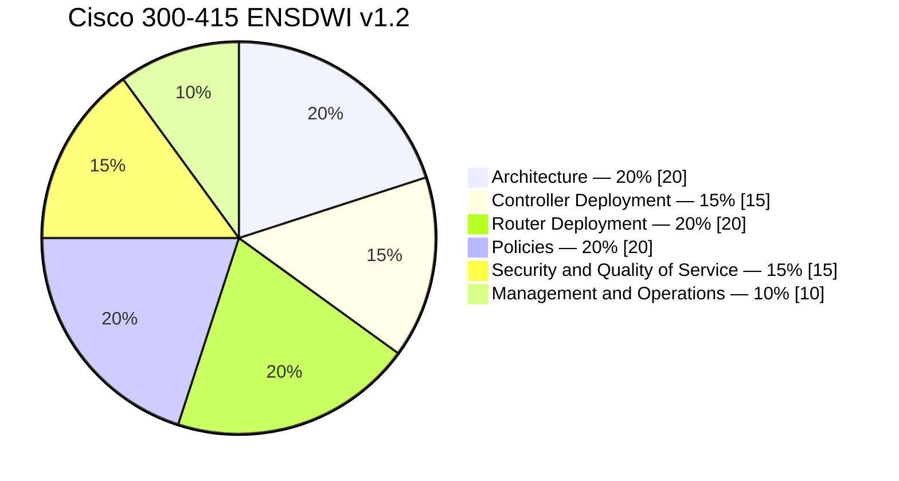
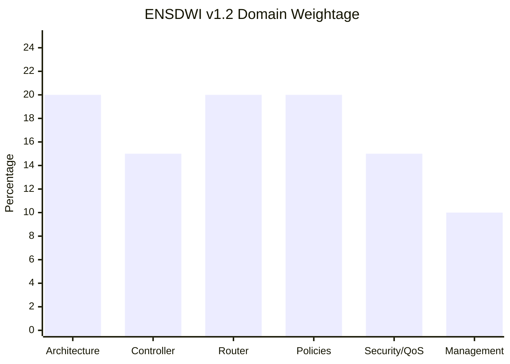
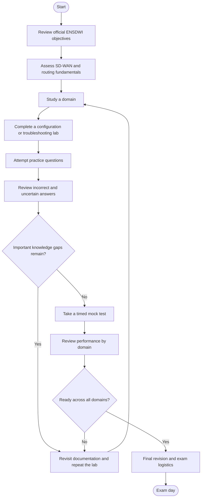
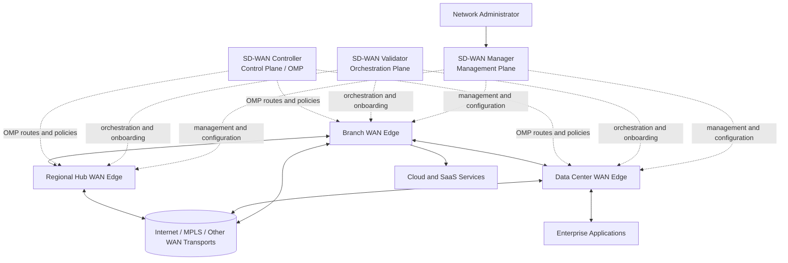
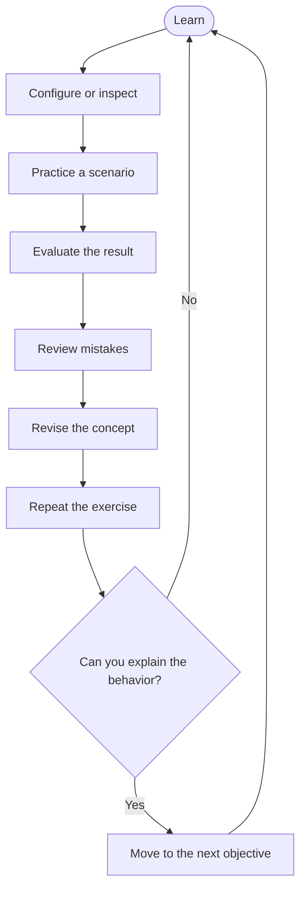
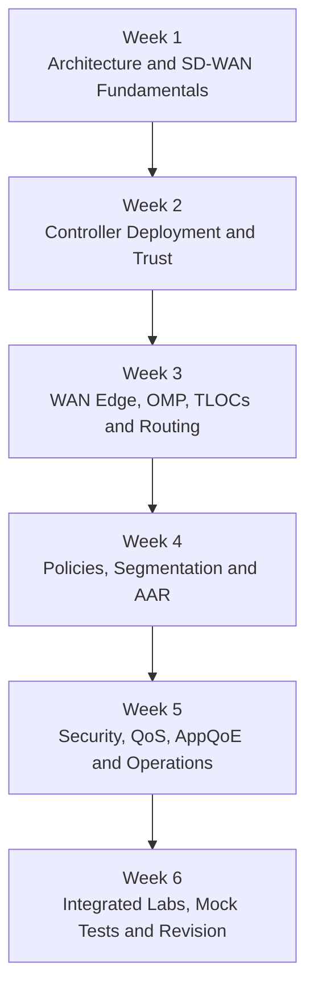
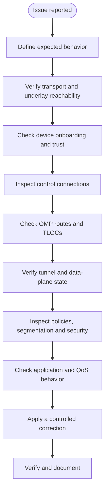

# Cisco 300-415 ENSDWI Study Guide

A practical study guide for **Cisco 300-415 ENSDWI — Implementing Cisco Catalyst SD-WAN Solutions**. This repository helps learners understand Catalyst SD-WAN architecture, controller deployment, WAN Edge onboarding, routing, centralized policies, application-aware routing, security, QoS, and operational troubleshooting.

The guide combines technical explanations, Mermaid diagrams, a structured study roadmap, hands-on project ideas, and original practice questions. Use it alongside Cisco's official exam topics and training documentation.

- **Exam code:** 300-415 ENSDWI
- **Exam name:** Implementing Cisco Catalyst SD-WAN Solutions
- **Provider:** Cisco
- **Official exam information:** [Cisco ENSDWI](https://www.cisco.com/site/us/en/learn/training-certifications/exams/ensdwi.html)

---

## Table of Contents

- [About the Certification](#about-the-certification)
- [Who Should Prepare?](#who-should-prepare)
- [Exam Details](#exam-details)
- [ENSDWI Exam Objectives](#ensdwi-exam-objectives)
- [Official Exam Domain Weightage](#official-exam-domain-weightage)
- [Certification Preparation Flowchart](#certification-preparation-flowchart)
- [Catalyst SD-WAN Architecture](#catalyst-sd-wan-architecture)
- [Study and Revision Cycle](#study-and-revision-cycle)
- [Step-by-Step Preparation Strategy](#step-by-step-preparation-strategy)
- [Six-Week Study Roadmap](#six-week-study-roadmap)
- [Hands-On Labs and Projects](#hands-on-labs-and-projects)
- [Original Practice Questions](#original-practice-questions)
- [Troubleshooting Checklist](#troubleshooting-checklist)
- [Common Preparation Mistakes](#common-preparation-mistakes)
- [Certification and Career Relevance](#certification-and-career-relevance)
- [Frequently Asked Questions](#frequently-asked-questions)
- [Official and Additional Resources](#official-and-additional-resources)
- [About CertsGate](#about-certsgate)

---

## About the Certification

Cisco 300-415 ENSDWI evaluates knowledge of implementing and operating Cisco Catalyst SD-WAN solutions. The exam covers the architecture and deployment of SD-WAN components, routing and policy configuration, security, Quality of Service (QoS), multicast, and network management.

Traditional WAN designs often rely on device-by-device configuration and manually maintained routing and policy decisions. Software-defined WAN introduces a more centralized approach to managing network behavior while using WAN Edge devices to forward traffic across available transport networks.

For example, a company might connect branch offices through broadband and private WAN circuits. With a correctly configured SD-WAN overlay, administrators can apply centralized policies, segment traffic, and steer selected applications according to path quality and business requirements.

The goal of preparation is to understand both the components and their interactions. Knowing the name of a controller is not enough; you should understand its role, how devices establish connectivity, how routes and policies are distributed, and how to investigate failures.

### What this study guide covers

- Catalyst SD-WAN architecture and components.
- Controller deployment and control-plane connectivity.
- WAN Edge onboarding and configuration management.
- Underlay and overlay connectivity.
- OMP, TLOCs, and service-side routing.
- Control policies, data policies, and VPN segmentation.
- Application-aware routing and Direct Internet Access.
- Security integration, QoS, and AppQoE.
- Monitoring, reporting, APIs, and troubleshooting.
- Practical lab ideas and original practice questions.

## Who Should Prepare?

This guide is intended for:

- Network engineers implementing or supporting SD-WAN.
- Enterprise network administrators managing branch connectivity.
- Network support engineers troubleshooting WAN overlays.
- Candidates pursuing the Cisco Certified Specialist – Enterprise SD-WAN Implementation certification.
- Professionals working toward CCNP Enterprise who want an SD-WAN concentration.

Cisco lists no formal prerequisite for the associated training. However, Cisco recommends familiarity with:

- Software-defined networking concepts.
- Enterprise WAN design.
- Interior and exterior routing protocols.
- Transport Layer Security (TLS).
- IPsec.

A strong understanding of routing and enterprise networking will make the controller, policy, and troubleshooting topics easier to learn.

---

## Exam Details

| Item | Published information |
|---|---|
| Exam code | 300-415 ENSDWI |
| Official exam name | Implementing Cisco Catalyst SD-WAN Solutions |
| Provider | Cisco |
| Duration | 90 minutes |
| Languages listed | English and Japanese |
| Published price | US$300, or Cisco Learning Credits |
| Specialist certification | Cisco Certified Specialist – Enterprise SD-WAN Implementation |
| CCNP Enterprise pathway | Can fulfill the concentration exam requirement when combined with the required core exam |
| Current topic outline used here | ENSDWI v1.2 |

Cisco's exam page is the reference for current exam logistics. The official topic outline describes the technologies and tasks that may appear; it does not guarantee that every individual exam delivery contains the same questions.

**Official reference:** [Cisco 300-415 ENSDWI exam page](https://www.cisco.com/site/us/en/learn/training-certifications/exams/ensdwi.html)

---

## ENSDWI Exam Objectives

The published v1.2 blueprint contains six domains. Use the sections below to organize study, then refer to Cisco's official document for the complete task-level wording.

### 1. Architecture — 20%

Understand how the components work together to create and operate the SD-WAN fabric.

Key areas:

- Orchestration plane and SD-WAN Validator, formerly vBond.
- Management plane and SD-WAN Manager, formerly vManage.
- Control plane and SD-WAN Controller, formerly vSmart.
- Overlay Management Protocol (OMP).
- Transport Locators (TLOCs) and vRoutes.
- WAN Edge data-plane functions.
- IPsec, GRE, and Bidirectional Forwarding Detection (BFD).
- Multi-Region Fabric.
- WAN Edge platform capabilities.
- Cloud OnRamp for SaaS, IaaS, colocation, and multicloud connectivity.

**Study goal:** Explain the purpose of each plane and component, and trace how management, control, and data-plane functions relate to one another.

### 2. Controller Deployment — 15%

Focus on controller deployment options, device trust, and control-plane connectivity.

Key areas:

- Cloud and on-premises deployment.
- Public and private hosting platforms.
- Controller installation concepts.
- Scalability, redundancy, and high availability.
- Certificates and device lists.
- Troubleshooting controller connectivity.

**Study goal:** Understand how controller deployment choices affect availability and how trust or connectivity problems can prevent devices from joining the fabric.

### 3. Router Deployment — 20%

This domain covers onboarding and configuring WAN Edge devices.

Key areas:

- Zero-Touch Provisioning (ZTP) and bootstrap processes.
- Data-center and regional-hub deployment.
- Circuit termination and TLOC extensions.
- Dynamic tunnels.
- Underlay and overlay connectivity.
- OMP configuration.
- TLOC configuration.
- CLI and SD-WAN Manager feature configuration templates.
- VRRP, OSPF, BGP, and EIGRP in the relevant SD-WAN context.
- Multicast support.
- Configuration groups, feature profiles, and workflows.

**Study goal:** Understand how an edge device is onboarded, configured, connected to the overlay, and integrated with service-side routing.

### 4. Policies — 20%

Policies control routing behavior, forwarding decisions, segmentation, and application treatment.

Key areas:

- Control policies.
- Data policies.
- VPN segmentation and membership.
- Custom network topologies.
- Application-aware routing (AAR).
- AI-driven Predictive Path Recommendation, as specified in the blueprint.
- Direct Internet Access (DIA).

**Study goal:** Distinguish policies that influence control-plane route distribution from those that influence data-plane traffic forwarding.

### 5. Security and Quality of Service — 15%

Prepare for security features, service insertion, traffic treatment, and application experience optimization.

Key areas:

- Service insertion.
- Application-aware enterprise firewall.
- Intrusion Prevention System (IPS).
- URL filtering.
- Advanced Malware Protection (AMP).
- SSL/TLS proxy.
- TrustSec.
- Cloud security integration, including DNS security and Secure Internet Gateway (SIG).
- QoS scheduling, queuing, shaping, policing, and marking.
- Per-tunnel and adaptive QoS.
- Application Quality of Experience (AppQoE).
- TCP optimization, Data Redundancy Elimination (DRE), packet duplication, Forward Error Correction (FEC), AppNav, and next-generation firewall concepts.

**Study goal:** Match a security or application-performance requirement to the relevant feature and understand its effect on traffic.

### 6. Management and Operations — 10%

This domain focuses on operating and monitoring the SD-WAN fabric.

Key areas:

- Authentication, monitoring, reporting, and troubleshooting through SD-WAN Manager.
- Monitoring and reporting configuration.
- REST API monitoring.
- Software image management.

**Study goal:** Know how to inspect operational state, identify useful telemetry, and approach routine management tasks.

---

## Official Exam Domain Weightage

The percentages below are from Cisco's published **300-415 ENSDWI v1.2** exam topic document. They are official domain weights, not a prediction of the precise number of questions on an individual exam.

### Domain distribution



### Weight comparison



### How to use the weights

- Give Architecture, Router Deployment, and Policies sustained attention because each carries 20%.
- Allocate dedicated study sessions to Controller Deployment and Security and Quality of Service, each at 15%.
- Reserve time for Management and Operations rather than leaving it until the last day.
- Use practice results to adjust the amount of revision needed in each domain.

A weighted plan helps allocate study time, but all objectives still matter. Do not ignore a topic simply because its domain has a lower percentage.

---

## Certification Preparation Flowchart

Follow this process to connect official objectives with practical work and readiness checks. If a knowledge gap remains, return to the relevant topic before taking another mock test.



Use this flowchart as a preparation method, not as a guarantee of passing. Readiness should be based on demonstrated understanding, not just a high score on one practice set.

---

## Catalyst SD-WAN Architecture

The following is a **conceptual learning diagram**, not a production reference design. It illustrates the broad relationship between centralized management and control functions, WAN Edge devices, transport networks, and application traffic.



### Understand the planes

| Component or concept | Main purpose |
|---|---|
| SD-WAN Manager | Centralized management, configuration workflows, monitoring, and operational visibility |
| SD-WAN Validator | Orchestration and onboarding-related functions |
| SD-WAN Controller | Control-plane functions and distribution of routing information and policies through OMP |
| WAN Edge | Connects sites to the SD-WAN fabric and forwards user traffic |
| Underlay | The IP connectivity provided by the underlying transport network |
| Overlay | The logical SD-WAN connectivity built over the underlay |
| OMP | Exchanges SD-WAN routing and related information between the control plane and edge devices |
| TLOC | Identifies a transport location used to describe an edge's transport attachment |
| BFD | Detects tunnel liveliness and helps the fabric react to connectivity changes |

Cisco's current naming differs from older training material. You may encounter vBond, vManage, and vSmart in legacy documentation. Learn to recognize these names as well as SD-WAN Validator, SD-WAN Manager, and SD-WAN Controller.

### Underlay versus overlay

| Concept | Underlay | Overlay |
|---|---|---|
| Purpose | Provides basic IP transport connectivity | Provides logical SD-WAN connectivity and policy-driven behavior |
| Common checks | Interfaces, addressing, routing, reachability | Control connections, OMP routes, TLOCs, tunnels, policies |
| Example failure | A transport circuit cannot reach its next hop | A route is not advertised or an overlay tunnel is unavailable |
| Troubleshooting approach | Verify the transport path first | Verify control-plane state, route distribution, tunnel state, and policy |

An overlay issue can be caused by an underlay failure. Check dependencies in order instead of assuming every SD-WAN problem originates in a controller or policy.

---

## Study and Revision Cycle

Preparation should be iterative. Learn a concept, test it, evaluate the evidence, and return to weak areas before moving on.



For each objective:

1. Read the official topic and supporting documentation.
2. Explain the technology in your own words.
3. Build or inspect a lab that demonstrates its behavior.
4. Verify the result using operational output.
5. Introduce a controlled failure if practical.
6. Record the root cause and correction.
7. Revisit the concept later without relying on notes.

---

## Step-by-Step Preparation Strategy

### Step 1: Review the blueprint before studying

Download the official v1.2 topic outline and use it as a checklist. Mark each objective as:

- **Not started**
- **Studying**
- **Practiced**
- **Ready for review**

This keeps preparation tied to the exam rather than allowing one interesting topic to consume all available time.

### Step 2: Learn the architecture and terminology

Start by understanding the management, orchestration, control, and data planes. Study OMP, TLOCs, vRoutes, transport connectivity, tunnels, and BFD.

Draw the architecture from memory and explain which component handles each task. Be able to describe what happens when a device is onboarded and how it begins participating in the overlay.

### Step 3: Understand controller deployment

Compare cloud and on-premises deployment at a conceptual level. Review certificates, device lists, controller connectivity, redundancy, and scalability.

For troubleshooting exercises, separate the questions:

- Can the device reach the required destinations?
- Is the device trusted and correctly onboarded?
- Are the expected control connections established?
- Is the device receiving the expected routes and policies?

Avoid making several configuration changes at once. Isolate the failing stage first.

### Step 4: Practice WAN Edge deployment

Study onboarding workflows, ZTP, bootstrap, feature profiles, configuration groups, and templates. Then connect the edge to a suitable lab topology.

Practice service-side routing with OSPF, BGP, and EIGRP where supported by the environment and relevant to the objectives. Understand the relationship between the local routing table and the routes exchanged through the SD-WAN overlay.

### Step 5: Study policies through scenarios

Learn control and data policies as different mechanisms.

- **Control policies** influence route distribution and topology behavior.
- **Data policies** influence how traffic is handled or forwarded.
- **Segmentation** separates traffic into logical VPNs.
- **Application-aware routing** can select paths according to application and link-performance requirements.
- **Direct Internet Access** allows selected traffic to exit locally when the design and policy permit it.

For every scenario, state the intended behavior before configuring the policy. Then verify whether the actual result matches the requirement.

### Step 6: Connect security and QoS to business needs

Review the security features listed in the blueprint, including firewall capabilities, IPS, URL filtering, TrustSec, and cloud security integration.

For QoS, understand the difference between marking, queuing, scheduling, shaping, and policing. Learn how these mechanisms affect traffic, and review the listed AppQoE features.

Use realistic examples: protecting a sensitive application, prioritizing voice traffic, or responding when a WAN circuit becomes congested.

### Step 7: Learn operations and monitoring

Practice reading operational status, monitoring information, reports, and troubleshooting evidence in SD-WAN Manager or an appropriate supported environment.

Review REST API monitoring and software image management concepts. The aim is to understand what the tools reveal and how the evidence helps narrow a fault.

### Step 8: Test readiness across all six domains

Take practice assessments after completing the relevant learning. Classify mistakes by objective and review the underlying concept before retesting.

Readiness is stronger when you can explain why a policy or route behaves as it does, recognize common failure patterns, and verify results using appropriate operational evidence.

---

## Six-Week Study Roadmap

This is an **independent suggested plan**, not an official Cisco timetable. Adjust it to your experience, lab access, and available study hours.



| Week | Main focus | Suggested outcome |
|---|---|---|
| 1 | Architecture, planes, OMP, TLOCs, underlay and overlay | Draw and explain the architecture |
| 2 | Controller deployment, certificates, connectivity, redundancy | Create a controller troubleshooting checklist |
| 3 | Edge onboarding, templates, routing, tunnels, multicast | Complete a deployment and routing exercise |
| 4 | Control/data policies, VPN segmentation, AAR, DIA | Document a policy scenario and verification steps |
| 5 | Security, QoS, AppQoE, Cloud OnRamp, monitoring, APIs | Build a topic-by-topic review sheet |
| 6 | Mixed-domain practice, troubleshooting, mock tests | Resolve weak areas and assess readiness |

A weekly routine can include concept study, lab practice, practice questions, and a review session. Increase the time devoted to a domain when your lab results or explanations show that the concept is not yet clear.

---

## Hands-On Labs and Projects

Practical exercises help connect the exam objectives to actual SD-WAN behavior. Use a supported Cisco lab, authorized sandbox, or simulator that provides the required features. Not every environment supports every controller or SD-WAN capability.

### Project 1: Map the SD-WAN architecture

**Goal:** Explain how the major components relate to one another.

Tasks:

1. Draw the management, orchestration, control, and data planes.
2. Label the Validator, Manager, Controller, and WAN Edge roles.
3. Add the underlay transport and overlay tunnels.
4. Show where OMP, TLOCs, and BFD fit.
5. Explain which component or path you would investigate for several example failures.

**Deliverable:** An architecture diagram and a short troubleshooting note.

### Project 2: Controller onboarding and connectivity

**Goal:** Understand the stages that allow an edge device to join the fabric.

Tasks:

1. Review the selected lab's controller and device onboarding process.
2. Identify required reachability and trust dependencies.
3. Review certificate and device-list concepts.
4. Examine the available control-connection status.
5. Work through a simulated onboarding failure.
6. Document the evidence that identified the failing stage.

**Deliverable:** A controller and onboarding checklist.

### Project 3: WAN Edge and service-side routing

**Goal:** Connect a branch edge to the overlay and its local network.

Tasks:

1. Examine or configure WAN transport connectivity.
2. Review the relevant onboarding and configuration workflow.
3. Configure a supported service-side routing protocol.
4. Verify local route learning.
5. Inspect the corresponding SD-WAN route information.
6. Test connectivity and document the route path.

**Deliverable:** A topology diagram with expected and observed routing behavior.

### Project 4: Policy and segmentation

**Goal:** Understand how policies influence route distribution and traffic handling.

Tasks:

1. Define a requirement for separating two traffic groups.
2. Identify the relevant VPN membership and segmentation model.
3. Distinguish control policy from data policy for the scenario.
4. Configure the feature in a supported environment.
5. Verify the resulting route or traffic behavior.
6. Document the impact of an incorrect or missing policy.

**Deliverable:** A policy design note with verification steps.

### Project 5: Application-aware routing and DIA

**Goal:** Explore application traffic treatment and path selection.

Tasks:

1. Identify two example applications with different performance requirements.
2. Review the path characteristics relevant to the scenario.
3. Study the application's AAR policy requirements.
4. Examine how the policy evaluates path performance.
5. Review the configuration and verification steps for DIA.
6. Record how the expected traffic path differs from ordinary forwarding.

**Deliverable:** An application-routing decision table.

### Project 6: Security and QoS

**Goal:** Relate network controls to traffic protection and performance.

Tasks:

1. Review the security features available in the lab environment.
2. Create a permitted-versus-denied traffic scenario.
3. Examine the effect of QoS marking, queuing, shaping, or policing.
4. Review a scenario involving application performance or loss.
5. Identify what evidence would help distinguish congestion from a policy problem.
6. Document the expected outcome and the verification evidence.

**Deliverable:** A short security and QoS troubleshooting report.

### Project 7: Operations and monitoring

**Goal:** Practice operational diagnosis and management.

Tasks:

1. Identify the available monitoring and reporting views.
2. Review device status and relevant alarms or events.
3. Inspect available troubleshooting information.
4. Explore REST API monitoring concepts using authorized access.
5. Review software image management workflows.
6. Record the steps you would follow to investigate an operational issue.

**Deliverable:** An operations checklist.

### Lab notes template

Keep each exercise reproducible:

```text
Lab title:
Related ENSDWI objective:
Environment and version:
Topology:
Requirement:
Initial state:
Configuration or inspection steps:
Verification evidence:
Fault or scenario:
Observed result:
Root cause or explanation:
Correction:
Final verification:
Lessons learned:
```

Do not include real passwords, private keys, production tokens, or confidential network configurations in a public repository.

---

## Original Practice Questions

The following are original educational questions created for this guide. They are **not official Cisco exam questions** and do not reproduce the live exam.

### Question 1: SD-WAN component roles

Which component is primarily associated with centralized management and configuration workflows in the Cisco Catalyst SD-WAN architecture?

A. WAN Edge  
B. SD-WAN Manager  
C. BFD  
D. TLOC

**Correct answer: B — SD-WAN Manager**

**Explanation:** SD-WAN Manager provides centralized management and operational capabilities. WAN Edge devices forward traffic, BFD detects liveliness, and TLOC identifies a transport location.

### Question 2: OMP

What is a central role of the Overlay Management Protocol (OMP) in Cisco Catalyst SD-WAN?

A. Assigning physical switch port numbers  
B. Exchanging SD-WAN routing information and related control-plane information  
C. Replacing all underlay routing  
D. Encrypting every application at the endpoint

**Correct answer: B**

**Explanation:** OMP participates in the SD-WAN control plane and exchanges routing information and related information between controllers and edge devices. It does not replace the underlay or serve as an endpoint encryption protocol.

### Question 3: Underlay and overlay

A branch WAN Edge loses IP reachability to its transport next hop. Overlay connectivity is also affected. What should be investigated first?

A. The underlay transport path and basic IP reachability  
B. Application URL categories only  
C. The final mock-test score  
D. The administrator's report formatting

**Correct answer: A**

**Explanation:** The overlay depends on underlay connectivity. Confirm the transport interface, addressing, and next-hop reachability before investigating higher-level overlay symptoms.

### Question 4: Control policy and data policy

An administrator needs to influence which routes are distributed to selected parts of an SD-WAN fabric. Which policy category is most directly relevant?

A. Control policy  
B. Software image management  
C. QoS marking alone  
D. Device inventory reporting

**Correct answer: A**

**Explanation:** Control policies influence route distribution and topology behavior. Data policies are more directly associated with how traffic is handled or forwarded.

### Question 5: QoS shaping

What is the main purpose of traffic shaping?

A. To encrypt every route advertisement  
B. To buffer and regulate traffic to a configured transmission rate  
C. To replace OMP  
D. To enroll a WAN Edge device

**Correct answer: B**

**Explanation:** Shaping regulates the transmission rate, commonly by buffering excess traffic. Policing typically enforces a rate by taking action on traffic that exceeds the configured policy.

### Question 6: Operations

An administrator wants to monitor the SD-WAN fabric through programmatic interfaces. Which subject from the published ENSDWI blueprint is especially relevant?

A. REST API monitoring  
B. EIGRP feasible successors only  
C. Physical cable labeling only  
D. Subnetting alone

**Correct answer: A**

**Explanation:** REST API monitoring is explicitly listed in the Management and Operations domain. Understand its purpose and how monitoring evidence supports operational workflows.

### How to use practice questions

For each question:

1. Choose an answer before checking the explanation.
2. Explain why the answer is correct.
3. Explain why the other options do not fit.
4. Identify the relevant official objective.
5. Revisit the documentation or lab if you guessed.
6. Retest the concept later with a different scenario.

Use mock tests to evaluate preparation and time management. Do not treat memorizing a question bank as a substitute for understanding the technology.

---

## Troubleshooting Checklist

When investigating an SD-WAN problem, avoid changing multiple settings without first identifying the failure domain.



### Troubleshooting questions

- Is the WAN Edge device onboarded and trusted?
- Can it reach the required controller and transport endpoints?
- Are expected control connections established?
- Are the expected OMP routes and TLOCs present?
- Is the underlay operational?
- Are overlay tunnels established and healthy?
- Is the relevant policy attached and behaving as intended?
- Is the traffic in the expected VPN or segment?
- Could security, QoS, or application treatment affect the result?
- What evidence confirms that the correction worked?

The exact commands and workflows depend on the Cisco SD-WAN software release, platform, and management mode. Use documentation that matches your lab version rather than assuming every command is universal.

---

## Common Preparation Mistakes

### Memorizing component names without understanding their roles

Be able to explain the purpose of each plane, controller, edge device, OMP, and TLOC. Architecture questions become easier when the relationships make sense.

### Confusing the underlay with the overlay

An overlay tunnel cannot function normally if its underlying transport is broken. Check basic reachability before assuming that the controller or policy is the root cause.

### Treating all policies as interchangeable

Control policies, data policies, segmentation, AAR, and QoS solve different problems. Learn the purpose and scope of each feature.

### Ignoring controller deployment and onboarding

Do not spend all your study time on routing and policy configuration. Certificates, device onboarding, controller connectivity, and redundancy are also included in the blueprint.

### Skipping security and AppQoE

Review the listed security integrations and traffic optimization features. Understand their purpose and the types of requirements they address.

### Taking mock tests without reviewing mistakes

A practice score is useful only when it leads to better understanding. Categorize each mistake, revisit the related objective, and repeat the exercise.

### Studying outdated terminology alone

Older materials may use vManage, vBond, and vSmart. Learn to recognize those names while understanding the current terminology used in Cisco's newer documentation.

---

## Certification and Career Relevance

ENSDWI topics are relevant to professionals who design, deploy, manage, and troubleshoot enterprise WAN connectivity.

Related roles include:

- Enterprise network engineer.
- Network implementation engineer.
- SD-WAN engineer.
- Network support engineer.
- Infrastructure operations engineer.

The skills can help with centralized network management, branch onboarding, WAN resiliency, traffic engineering, security integration, and application performance.

Passing the exam does not guarantee a job or a particular career outcome. Practical experience, lab work, communication skills, and continued technical learning remain important.

---

## Frequently Asked Questions

### What is Cisco 300-415 ENSDWI?

It is Cisco's Implementing Cisco Catalyst SD-WAN Solutions exam. It covers SD-WAN architecture, controller deployment, WAN Edge deployment, policies, security, QoS, multicast, and management and operations.

### How long is the ENSDWI exam?

Cisco lists a duration of 90 minutes. Confirm the current details on the [official exam page](https://www.cisco.com/site/us/en/learn/training-certifications/exams/ensdwi.html).

### What are the ENSDWI exam domains?

The published v1.2 blueprint has six domains: Architecture, Controller Deployment, Router Deployment, Policies, Security and Quality of Service, and Management and Operations.

### What are the official domain percentages?

The v1.2 topic outline lists Architecture at 20%, Controller Deployment at 15%, Router Deployment at 20%, Policies at 20%, Security and Quality of Service at 15%, and Management and Operations at 10%.

### Does ENSDWI count toward CCNP Enterprise?

Yes. Cisco identifies ENSDWI as a concentration exam that can fulfill the concentration requirement when combined with the required CCNP Enterprise core exam. Passing it also earns the Cisco Certified Specialist – Enterprise SD-WAN Implementation certification. Review Cisco's [CCNP Enterprise page](https://www.cisco.com/site/us/en/learn/training-certifications/certifications/enterprise/ccnp-enterprise/index.html) for current requirements.

### How much preparation time is needed?

There is no universal preparation duration. Your starting knowledge, lab access, and study schedule all matter. The six-week roadmap is a suggested structure, not a promise of readiness.

### Are practice questions enough?

Practice questions can help identify gaps, but they should be combined with official documentation, architecture study, hands-on exercises, and review of incorrect answers.

### Does this repository contain real exam questions?

No. Questions in this repository are original educational examples. They are not presented as official, live, leaked, or guaranteed Cisco exam questions.

### Where can I verify the current objectives?

Use the official [Cisco ENSDWI exam page](https://www.cisco.com/site/us/en/learn/training-certifications/exams/ensdwi.html) and its linked exam-topic document.

---

## Official and Additional Resources

### Cisco resources

- [Cisco 300-415 ENSDWI exam page](https://www.cisco.com/site/us/en/learn/training-certifications/exams/ensdwi.html) — current exam information and preparation options.
- [Official ENSDWI v1.2 exam topics PDF](https://learningcontent.cisco.com/documents/marketing/exam-topics/300-415-ENSDWI-v1.2-7-2025.pdf) — domain percentages and task-level objectives.
- [Cisco ENSDWI training course](https://www.cisco.com/site/us/en/learn/training-certifications/training/courses/ensdwi.html) — learning objectives, recommended background, course outline, and labs.
- [Cisco U.](https://u.cisco.com/) — Cisco learning paths and training.
- [Cisco certification exams list](https://www.cisco.com/site/us/en/learn/training-certifications/exams/list.html) — broader exam catalog.
- [Cisco CCNP Enterprise certification](https://www.cisco.com/site/us/en/learn/training-certifications/certifications/enterprise/ccnp-enterprise/index.html) — certification pathway and requirements.
- [Cisco technical support and documentation](https://www.cisco.com/c/en/us/support/index.html) — platform and technology documentation.

---

## About CertsGate

[CertsGate](https://certsgate.com/) is an independent IT certification preparation resource. Learners preparing for 300-415 ENSDWI can explore relevant study material and practice resources as part of a wider study plan.

A useful approach is to establish the scope from Cisco's official exam topics, learn the architecture and deployment concepts, practice policies and troubleshooting in an appropriate lab, and use practice questions to evaluate understanding.

Third-party resources should complement—not replace—the official exam blueprint and technical documentation.

---
